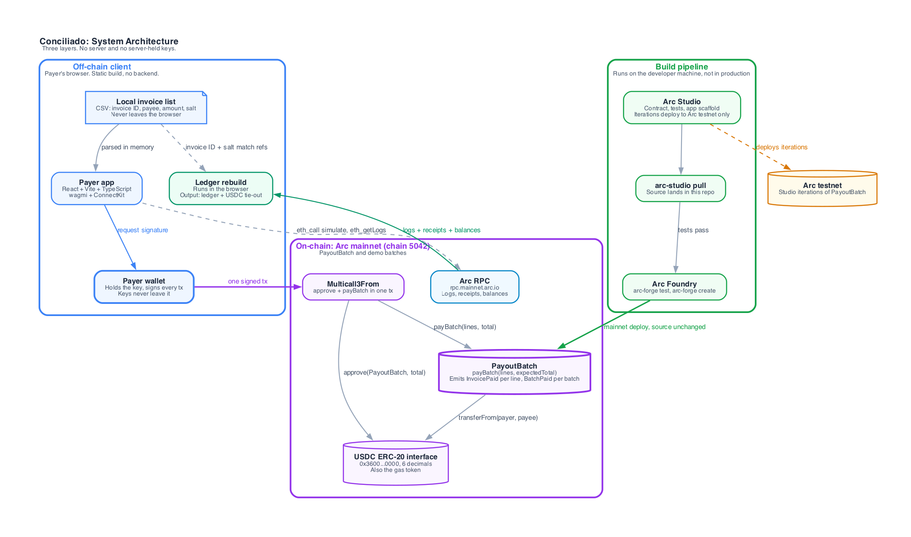
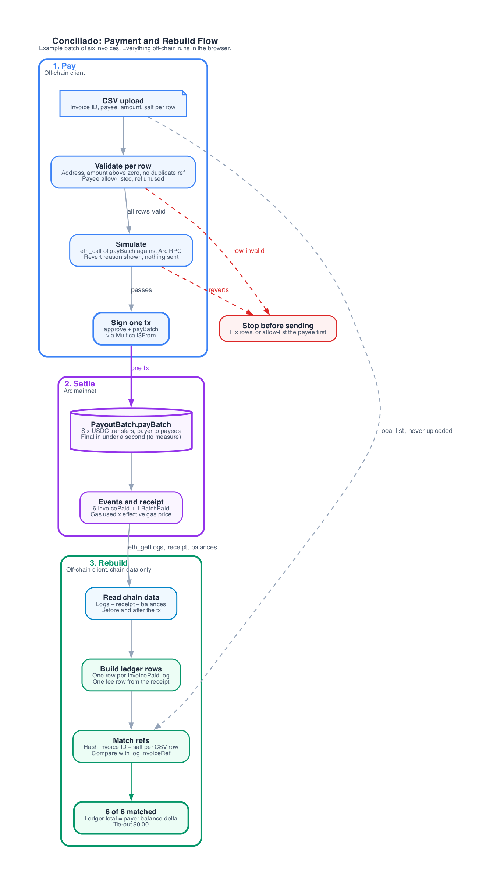

# Conciliado

Pay a batch of contractor invoices in USDC on Arc in one transaction, with every payment
stamped with its invoice reference, so the books can be rebuilt from the chain and nobody
reconciles by hand.

Conciliado is two pieces. `PayoutBatch` is a small contract that moves USDC from the payer
to each payee and emits one event per invoice line. A ledger rebuild reads those events,
the receipt, and the payer's balances back from Arc and checks that the ledger ties to the
payer's USDC balance change. The contract and the rebuild are built, and the contract is
live on Arc mainnet. The web app around them is not built yet (see [Status](#status)).

Built for Arc Microgrants: Built with Arc Studio.

## The problem

Paying contractors in a batch usually leaves a list of transfers that someone matches to
invoices by hand, with the network fee booked somewhere else, if at all. Conciliado puts
the invoice reference in the payment itself. On Arc, gas is paid in USDC, so the fee is in
the same unit as the payouts and can be booked next to them.

This README does not quote industry statistics. The only numbers in it come from the first
real batch, documented in [docs/deployments/mainnet.md](docs/deployments/mainnet.md): six
invoice lines, 0.195 USDC paid out, a 0.011013954 USDC network fee, and a ledger that
differs from the payer's balance change by 0.

## Status

### Live on Arc mainnet (chain 5042)

| Item | Link |
| --- | --- |
| `PayoutBatch` contract | [`0xC86e2241166785344E4d6692E4D2A3D4c8466d0e`](https://explorer.arc.io/address/0xC86e2241166785344E4d6692E4D2A3D4c8466d0e) |
| Deploy transaction | [`0xc7d5cba3...ff800f`](https://explorer.arc.io/tx/0xc7d5cba3e626bb8c4449075cb712b58a558928d2f5ce28e0b9d1119841ff800f) |
| Allow-list setup for the six payees (`addPayees`) | [`0x8d8652df...f89f36`](https://explorer.arc.io/tx/0x8d8652df005fe8cbfccb79afa8ed750c56be365dcd6e58fcdb87f3aaf7f89f36) |
| First batch: 6 invoice lines, 0.195 USDC, one transaction | [`0x50d56ea9...100987056`](https://explorer.arc.io/tx/0x50d56ea910e0412c47a7dc186b5f89ccf7cbe71235db799379874d6100987056) |

The ledger rebuild ties that batch out: 6 of 6 invoice references matched, ledger total
equal to the payer's balance change, difference $0.00. You can reproduce it with the
commands [below](#run-it).

### What is a fixture

- `fixtures/mainnet-batch-1.csv` and `fixtures/mainnet-batch-1.json` describe the batch
  above. The `ledger:rebuild` command takes only the contract, payer, transaction hash,
  and invoice list from them; every number it prints is read from the chain. The offline
  tests use the same files as recorded chain data.
- The invoice IDs (`INV-0001` to `INV-0006`) are demo IDs, and the six payees are fresh
  wallets made for the demo. The money and the transactions are real; the invoices are
  not.
- The first batch was sent from the command line, not from an app.

### Designed, not built into screens yet

- The brand book and design system are written ([docs/brand-book.md](docs/brand-book.md),
  [docs/design-system.md](docs/design-system.md)) with tokens in
  [docs/brand/](docs/brand/). Response-time targets are in [docs/performance.md](docs/performance.md);
  none of them is measured yet.

### Not built yet

- The landing page that shows a read-only rebuild of a real mainnet batch.
- The run-a-batch flow (CSV upload, validation, simulation, one signed transaction).
- A live URL. There is no deployed site yet, so there is nothing to open in a browser.
- The demo-path end-to-end test, the threat model, and the demo video.

Open work is tracked in the [issues](https://github.com/salazarsebas/conciliado/issues).

### Known issues

- `bun run typecheck` and `bun run lint` fail outside the Arc Studio sandbox
  ([#27](https://github.com/salazarsebas/conciliado/issues/27)). The only errors are in
  `scripts/compass-deploy.ts`, which imports `@circlefin/compass-chains`, a package that
  is not on the public npm registry. The ledger code and the contract tests are not
  affected.
- Source verification on explorer.arc.io is not done. The explorer answers command line
  clients with a Cloudflare challenge, so `arc-forge verify-contract` failed. The
  standard JSON input and the manual steps are in
  [docs/deployments/mainnet.md](docs/deployments/mainnet.md#source-verification). The
  deployed bytecode was compared with the local build instead: same length, differing only
  in the constructor-filled `USDC` immutable.

## Architecture



There are three layers. There is no application server, no database, and no server-held
key. The payer's wallet signs every transaction.

- **Off-chain client** (the payer's browser, a static build). Holds the invoice CSV in
  memory, builds the batch, asks the wallet to sign, and rebuilds the ledger. It reads
  from Arc RPC and never uploads the invoice list. The chain stores only an opaque
  `bytes32` reference per line; the mapping from invoice to reference stays with the
  payer. Today only the rebuild exists, as a library in `src/ledger/` and a Bun command.
- **On-chain, Arc mainnet.** `PayoutBatch` (`payBatch(lines, expectedTotal)` does one
  `transferFrom(payer, payee, amount)` per line, emits `InvoicePaid` per line and
  `BatchPaid` per batch, and holds no funds); the system contract `Multicall3From`, which
  runs `approve` and `payBatch` in one transaction with the payer as sender; and the USDC
  ERC-20 interface at `0x3600000000000000000000000000000000000000` (6 decimals, also the
  gas token).
- **Build pipeline** (developer machine). Arc Studio authors the code, `arc-studio pull`
  brings it into this repo, and Arc Foundry runs the tests and deploys to mainnet. Arc
  Studio itself deploys to Arc testnet only.

The boundaries in one line each: the browser never holds a key, the chain never sees an
invoice ID, and nothing between the browser and Arc RPC is operated by this project.

The mainnet, testnet, and off-chain table and the address list are in
[docs/architecture.md](docs/architecture.md). The diagrams, each with a Markdown twin for
agents: [system architecture](docs/diagrams/01-system-architecture.md),
[payment and rebuild flow](docs/diagrams/02-payment-and-rebuild-flow.md),
[deploy split](docs/diagrams/03-deploy-split.md) (images in
[docs/diagrams/output](docs/diagrams/output)).

## How it works



1. The payer provides a CSV with an invoice ID, payee, amount, and salt per row.
2. The client validates each row: valid address, amount above zero, no duplicate
   reference, payee on the payer's allow-list, reference unused. A bad row stops the
   batch before anything is sent.
3. The client simulates `payBatch` with `eth_call` against Arc RPC. A revert shows its
   reason and nothing is sent.
4. The payer signs one transaction that runs `approve` and `payBatch` through
   `Multicall3From`.
5. `PayoutBatch` pays every line on Arc mainnet and emits one `InvoicePaid` per line plus
   one `BatchPaid`.
6. The rebuild reads the logs, the receipt, and the payer's balance before and after the
   batch block.
7. It builds one ledger row per `InvoicePaid` log and one fee row from the receipt
   (`gasUsed` times `effectiveGasPrice`, in USDC).
8. It matches each CSV row to a log: the reference is `keccak256(invoiceId ++ salt)`.
9. It ties out: the ledger total equals the payer's balance change, exactly, in the
   18-decimal native unit.

Steps 5 to 9 are done and reproducible for the first batch. Steps 1 to 4 are the app and
are not built yet. The rebuild rules (which logs are counted, why the duplicate 18-decimal
`Transfer` logs are ignored, how the fee is rounded) are in
[docs/ledger-rebuild.md](docs/ledger-rebuild.md).

## How Arc Studio was used

The product code was authored in [Arc Studio](https://studio.arc.io) and pulled into this
repo with `arc-studio pull`: the `PayoutBatch` contract and its Foundry tests, the app
scaffold (`src/`, `scripts/`), and the ledger rebuild library. The Conciliado project in
Arc Studio is
[here](https://studio.arc.io/app/00732eb6-0372-4443-b5a3-2fa761fc0c3c); whether it opens
without an Arc Studio account depends on its sharing settings, which have not been
checked. Studio also ran its Solidity and functional auditors and Slither on the
contract. The findings and what was done about them are in
[docs/contracts/payout-batch.md](docs/contracts/payout-batch.md). Studio states that its
review is best effort and not a substitute for a paid third-party audit before real
funds.

Mainnet was deployed with Arc Foundry because Arc Studio deploys to Arc testnet only. The
same pulled `contracts/PayoutBatch.sol` went to mainnet unchanged, after `arc-forge test`
passed (22 passed, 0 failed). The testnet deployment of the Studio iteration is at
[`0x209dd046...1fb6`](https://explorer.testnet.arc.io/address/0x209dd04647d4c103081095176e5f58c5d91e1fb6).
The Studio to mainnet path was first tried on a throwaway contract, see
[docs/spikes/arc-studio-path.md](docs/spikes/arc-studio-path.md).

## Run it

Each command below was run in a fresh git worktree of `main`. None of them sends a
transaction or needs a key.

### 1. Install

You need [Bun](https://bun.sh) 1.3.14 (see `.bun-version`).

```bash
git clone https://github.com/salazarsebas/conciliado.git
cd conciliado
bun install --frozen-lockfile
```

Install before running the contract tests: the contracts import OpenZeppelin from
`node_modules`.

### 2. Contract tests with Arc Foundry

Install Arc Foundry from the
[arc-foundry releases](https://github.com/circlefin/arc-foundry/releases). Assets exist
for macOS on Apple Silicon and for Linux. Download the archive for your platform and its
`.sha256`, check the hash, extract it, and put its `forge` binary on your `PATH` under the
name `arc-forge`. The version used here is v0.8.0-2; `arc-forge --version` prints
`forge Version: 1.7.1-dev`. `forge-std` is vendored in `lib/`.

```bash
arc-forge test
```

Expected: `22 tests passed, 0 failed, 0 skipped`. Add `--force` to recompile from scratch.

### 3. Ledger tests

```bash
bun run test
```

Expected: `42 pass`, `0 fail`. They run offline against recorded chain data in
`fixtures/`.

### 4. Rebuild the first mainnet batch, read-only

```bash
bun run ledger:rebuild
```

This reads Arc mainnet through `https://rpc.mainnet.arc.io` (set `RPC_URL` to use another
endpoint), signs nothing, and exits 1 if the difference is not 0 or a reference is
unmatched. The lines that matter in the output:

```text
Matched 6 of 6
differenceWei        : 0 wei
differenceDisplay    : $0.00
```

Cross-check the batch on the
[explorer](https://explorer.arc.io/tx/0x50d56ea910e0412c47a7dc186b5f89ccf7cbe71235db799379874d6100987056).

## Repository map

| Path | What is there |
| --- | --- |
| `contracts/` | `PayoutBatch.sol` and its tests, pulled from Arc Studio |
| `src/ledger/` | Ledger rebuild and tie-out library, with tests |
| `scripts/rebuild-ledger.ts` | The `ledger:rebuild` command |
| `scripts/brand-tokens.ts` | The `brand:tokens` and `brand:check` commands for the design tokens |
| `fixtures/` | The first mainnet batch as CSV and recorded chain data |
| `diagrams/generator/` | Graphviz sources for the diagrams |
| `docs/` | Architecture, deployment record, ledger rebuild notes, brand book, design system, response times, contract notes, spike, standards |
| `docs/brand/` | Design tokens (JSON, CSS variables, Tailwind theme) and the logo mark |
