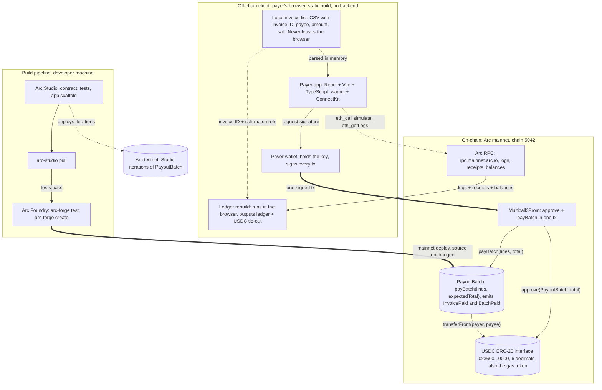

# System architecture (agent twin)

Markdown twin of `01-system-architecture`. Keep this in lockstep with
`diagrams/generator/01-system-architecture.py`. Image: `output/01-system-architecture.svg`
and `.png`.

There is no application server and no server-held key. The payer's browser talks to the
wallet and to Arc RPC. The payer's wallet signs every transaction.

Layers:

- **Off-chain client** (payer's browser, static build): local invoice list, payer app,
  ledger rebuild. The wallet is the payer's own and sits beside the app.
- **On-chain, Arc mainnet (chain 5042)**: `Multicall3From`, `PayoutBatch`, the USDC
  ERC-20 interface at `0x3600000000000000000000000000000000000000` (6 decimals, also the
  gas token), and the Arc RPC endpoint `https://rpc.mainnet.arc.io`.
- **Build pipeline** (developer machine): Arc Studio, `arc-studio pull`, Arc Foundry.
  Studio iterations deploy to Arc testnet only.

## Edges

| From | To | Meaning |
| --- | --- | --- |
| Local invoice list | Payer app | CSV parsed in memory, never uploaded |
| Payer app | Payer wallet | Request a signature |
| Payer wallet | Multicall3From | One signed transaction |
| Multicall3From | USDC | `approve(PayoutBatch, total)` |
| Multicall3From | PayoutBatch | `payBatch(lines, total)` |
| PayoutBatch | USDC | `transferFrom(payer, payee)` per line |
| Payer app | Arc RPC | Simulate with `eth_call`, read with `eth_getLogs` |
| Arc RPC | Ledger rebuild | Logs, receipts, balances |
| Local invoice list | Ledger rebuild | Invoice ID and salt, to match each `invoiceRef` |
| Arc Studio | Arc testnet | Iterations deploy to testnet |
| Arc Studio | `arc-studio pull` | Source lands in the repo |
| `arc-studio pull` | Arc Foundry | Tests pass under `arc-forge test` |
| Arc Foundry | PayoutBatch | `arc-forge create` to mainnet, source unchanged |
