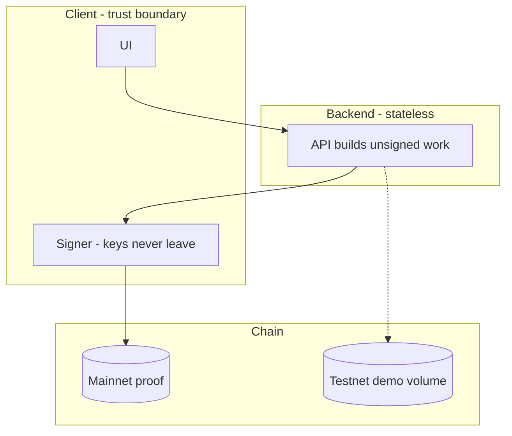

# System architecture (agent twin)

Markdown twin of `01-system-architecture`. Keep this in lockstep with the Graphviz
script. Agents should be able to reconstruct the split from this file alone.

**Deploy split:** extra-credit proof on mainnet. Demo volume on testnet. API is
stateless and holds no keys. Signing stays in the client.

