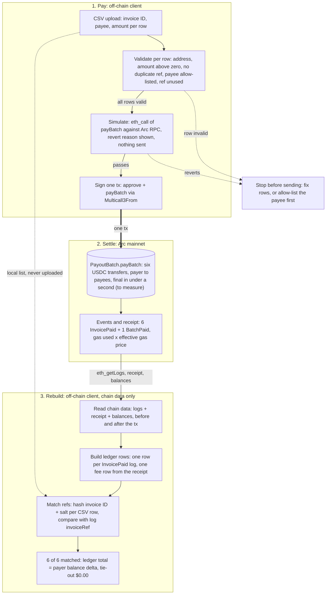

# Payment and rebuild flow (agent twin)

Markdown twin of `02-payment-and-rebuild-flow`. Keep this in lockstep with
`diagrams/generator/02-payment-and-rebuild-flow.py`. Image:
`output/02-payment-and-rebuild-flow.svg` and `.png`.

The example batch has six invoice lines. Steps 1 and 3 run in the browser. Step 2 is one
Arc mainnet transaction. `PayoutBatch.payBatch` reverts for a payee that is not on the
payer's allow-list, so validation checks the allow-list and a missing payee is added
first with `addPayees`.

## Steps

| # | Step | Where | Output |
| --- | --- | --- | --- |
| 1 | CSV upload | Browser | Rows held in memory |
| 2 | Validate per row | Browser | Pass, or a list of bad rows and no transaction |
| 3 | Simulate | Browser, Arc RPC | Pass, or a revert reason and no transaction |
| 4 | Sign one tx (`approve` + `payBatch`) | Wallet | One transaction |
| 5 | Settle | Arc mainnet | 6 `InvoicePaid`, 1 `BatchPaid`, a receipt |
| 6 | Read chain data | Browser, Arc RPC | Logs, receipt, balances before and after |
| 7 | Build ledger rows | Browser | 6 payment rows, 1 fee row |
| 8 | Match refs | Browser | Each CSV row matched to a log by `invoiceRef` |
| 9 | Tie out | Browser | 6 of 6 matched, ledger total equals the payer's balance change, difference $0.00 |
