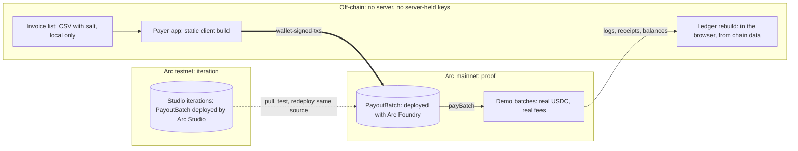

# Deploy split (agent twin)

Markdown twin of `03-deploy-split`. Keep this in lockstep with
`diagrams/generator/03-deploy-split.py`. Image: `output/03-deploy-split.svg` and `.png`.
The table form is in `docs/architecture.md`.

